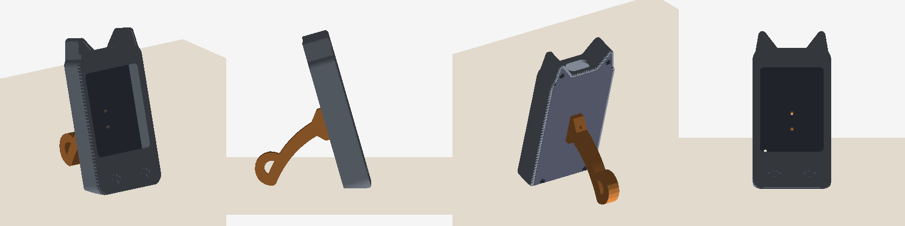

# 🐱 DigiCat - Virtual Pet for the ESP32 "Cheap Yellow Display"

A tiny cat that lives on your desk. Feed it, play with it, stroke it, put it to bed,
and watch it grow from kitten to adult cat. It remembers everything across power cycles.



## ✨ What's new in v2

- **Smooth animations**: the room is drawn off-screen and pushed in one go, so no more flicker.
- **Never blocks**: animations run while the touch screen stays responsive (v1 froze for up to 2 s per action).
- **Saves your cat** to flash: stats and age survive a reboot.
- **Four needs**: Food, Fun, Energy, Health. All bars mean "higher is better".
- **Sleep mode**: lights off, the cat curls up and recovers energy, and the backlight dims.
- **Stroke the cat** for hearts. Stroking repeatedly keeps it purring, but it can't be spammed for points.
- **Safe reset**: hold the title bar for 3 s, then confirm. No more accidental RESET button.
- **Touch calibration** on first boot, saved to flash.
- **Auto-dim** after 90 s idle. The on-board LED blinks red when the cat needs you.
- **One sketch for both boards**, configured in code. No more copying `User_Setup.h` into a library.
- **New 3D-printed case** shaped like a cat's head, with a tail stand.

## 🛠️ Hardware

| Board | Display | Status |
|---|---|---|
| **ESP32-2432S024R** (CYD 2.4") | 240x320, ST7789 or ILI9341, resistive | default, case included |
| **ESP32-2432S028R** (CYD 2.8") | 240x320 ILI9341, resistive | set `DIGICAT_BOARD` in `config.h` |

## 🚀 Quick start: web flasher

1. Open **[the DigiCat web flasher](https://aquascape123.github.io/digicat/web_flasher)** in Chrome or Edge
2. Pick your board size, connect it over USB, then click *Install*
3. On first boot, tap the four arrow tips to calibrate the touch screen

## 🔧 Build it yourself

1. Arduino IDE 2.x with **esp32 by Espressif** (built and tested with 2.0.14)
2. Library Manager: install **LovyanGFX**. TFT_eSPI and XPT2046_Touchscreen are no longer needed.
3. Open `firmware/DigiCat/DigiCat.ino`, check the board in `config.h`
4. Board: **ESP32 Dev Module**, then Upload

Command line:
```bash
arduino-cli compile --fqbn esp32:esp32:esp32 firmware/DigiCat
```
For the 2.8" board, add `--build-property "compiler.cpp.extra_flags=-DDIGICAT_BOARD=2"`.

### If something looks wrong
- **Wrong colours or inverted image**: in `config.h`, set `PANEL_IS_ILI9341 1` (2.4" boards ship with either controller), or flip `PANEL_INVERT` / `PANEL_RGB_ORDER`.
- **Upside down**: change `SCREEN_ROTATION` (0 or 2).
- **Touch is off**: hold a finger on the screen during the splash to calibrate again.
- **Testing the game**: set `SIM_MINUTE_MS` to `1000` to run 60x faster.

## 🎮 How to play

| | |
|---|---|
| 🐟 **FEED** | +Food. A full cat refuses, so check the bar first |
| ⚽ **PLAY** | +Fun, but costs Energy and a bit of Food. A tired cat won't play |
| 🌙 **SLEEP / WAKE** | Lights off: Energy recovers quickly. The cat wakes up by itself when rested |
| 👋 **Touch the cat** | Hearts and a little Fun |
| ⏱️ **Hold the title** | 3 s, then confirm, to start over with a new kitten |

Health drops slowly while any need is critical, and recovers while all of them are fine.
A very tired cat falls asleep on its own. Kitten → Young cat after 1 h → Adult cat after 6 h
(powered-on time). All rates are in `config.h`.

## 🖨️ The case

A cat-head shell with ears. The USB-C cable comes out between the ears, and a curled tail
holds the screen at 16°. Four parts, all in `case/stl`:

| Part | Print orientation | Notes |
|---|---|---|
| `digicat_fit_test.stl` | face down | **Print this first** (~20 min): drop the board in and check the screen opening |
| `digicat_body.stl` | face down (textured plate looks great) | inner ears and paw prints are 0.6 mm deep, so you can fill them with a second colour |
| `digicat_back.stl` | outer face down | 4 posts clamp the PCB against the front |
| `digicat_tail.stl` | on its side | the stand |

PLA/PETG, 0.2 mm layers, 3 walls, no supports.

**Hardware:** 6x M2 self-tapping screws, 6-8 mm long: 4 hold the back plate, 2 fix the tail from the inside.

**Assembly:** screw the tail onto the back plate (screw heads go on the inside) → put the board
face down into the body → close with the back plate.

### Adjusting the case
The case is generated by `case/build_case.py`. All dimensions are parameters at the top of the file.
```bash
pip install manifold3d trimesh numpy
python case/build_case.py
```
If the fit test shows the screen opening is off-centre, change `WIN_Y`. Other parameters:
`LCD_STACK` for display thickness, `TILT` for the viewing angle, `LIGHT_X/LIGHT_Y` to move the
LED glow spot.

## 📁 Project structure
```
firmware/DigiCat/   Arduino sketch (config.h, display.h, pet.*, art.*, ui.*)
case/               case generator, STL files, preview
web_flasher/        browser-based installer (ESP Web Tools)
```

## 📄 License
MIT, see [LICENSE](LICENSE).

## 🙏 Credits
LovyanGFX by lovyan03, the ESP32 Arduino core by Espressif, and the CYD community.
